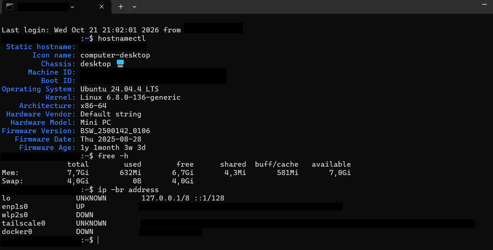

# Home Lab — Sistemas, Redes y Seguridad

Laboratorio doméstico personal desarrollado como parte de mi aprendizaje en el Ciclo Formativo de Grado Superior en Administración de Sistemas Informáticos en Red (ASIR).

El objetivo de este proyecto es adquirir experiencia práctica en administración de sistemas Linux, servicios de red, acceso remoto y seguridad informática.

## Infraestructura

- **Servidor:** Mini PC Withtech
- **Procesador:** Intel Pentium J3710 (4 núcleos)
- **Memoria RAM:** 8 GB DDR3L
- **Almacenamiento:** SSD SATA III de 128 GB
- **Sistema operativo:** Ubuntu Server 24.04 LTS
- **Administración:** Interfaz de línea de comandos (CLI)

**Sistema y recursos (Captura)**

## Dispositivo móvil

- **Dispositivo:** Google Pixel 7a.
- **Sistema operativo:** GrapheneOS, basado en Android y orientado a la privacidad y la seguridad.
- **Acceso remoto:** Termius para conectarme al servidor mediante SSH.
- **Herramientas adicionales:** Termux para utilizar una terminal local y Fing para analizar dispositivos de la red.
- **Gestión de credenciales:** Proton Pass.

## Tecnologías y servicios

- **Linux:** administración de Ubuntu Server.
- **SSH:** administración remota mediante claves.
- **Tailscale:** acceso remoto a través de una red privada virtual.
- **Netplan:** configuración de red.
- **UFW:** control del tráfico mediante firewall.
- **Fail2Ban:** protección frente a intentos repetidos de autenticación.
- **MariaDB:** gestión de bases de datos relacionales.
- **Samba:** intercambio de archivos en red.
- **Docker:** despliegue de servicios mediante contenedores.

## Seguridad y acceso remoto

En una primera fase, el acceso remoto se configuró mediante redirección de puertos en el router. Posteriormente, se modificó la arquitectura para evitar exponer el servicio SSH directamente a Internet.

Las medidas de seguridad documentadas en la configuración actual incluyen:

- Eliminación de la redirección de puertos SSH en el router.
- Acceso remoto mediante Tailscale.
- Autenticación SSH basada en claves ED25519.
- Desactivación de la autenticación SSH mediante contraseña.
- Configuración de UFW para restringir el tráfico entrante.
- Uso de Fail2Ban para gestionar intentos de autenticación fallidos.
- Copias de seguridad de los archivos de configuración antes de modificarlos.

## Objetivos de aprendizaje

- Practicar la administración y el mantenimiento de sistemas Linux.
- Configurar y gestionar servicios de red.
- Aplicar medidas de seguridad al acceso remoto.
- Comprender el funcionamiento de las VPN y los firewalls.
- Documentar configuraciones, pruebas y mejoras del laboratorio.

## Próximas mejoras

- Diseñar e implementar una segmentación de red mediante VLAN.
- Ampliar la documentación técnica con capturas y pruebas.
- Incorporar nuevos servicios y prácticas relacionadas con sistemas, redes y ciberseguridad.

## Estado del proyecto

Laboratorio personal en desarrollo. La documentación se actualizará a medida que se implementen, prueben y validen nuevas configuraciones.
